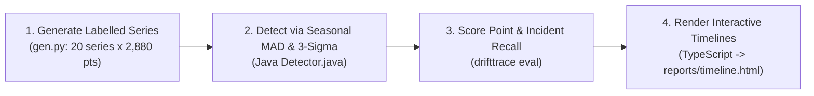

# drifttrace

[English](README.md) | [简体中文](README.zh-CN.md)

**Alert on incidents, not on threshold crossings.** `drifttrace` detects metric
anomalies with a seasonal baseline and a robust z-score, then scores itself
against labelled incidents — precision, recall, detection rate, and false alarms
per series — next to a plain 3-sigma threshold run on the same data.

```console
$ python scripts/demo.py
rolling        P 0.934  R 0.579  F1 0.715   detected 100/108  false alarms 40
baseline       P 1.000  R 0.017  F1 0.033   detected 36/108  false alarms 0
```

That contrast is the point. The baseline has perfect precision and misses
two-thirds of the incidents, because it only reacts to points that are far from
the global mean: it catches spikes and almost nothing else.

## Workflow



## How the detector works

1. **Seasonal baseline.** Each sample is compared with the median of the same
   time-of-day on the previous three days. A centred rolling median was the first
   implementation; it dragged every level shift out over half a window in both
   directions, which made the reported interval much longer than the incident.
2. **Robust scale.** One median absolute deviation for the whole residual series,
   not a rolling one. A rolling window that contains a 70-sample shift inflates
   its own scale and hides the very thing it is judging.
3. **Two masks, two persistence rules.** A z-score mask catches spikes, dips, and
   level shifts; a smoothed short/long standard-deviation ratio catches variance
   regimes, which leave the mean untouched. The variance mask gets a longer
   persistence rule, because a spike also inflates the local standard deviation.
4. **Merging.** Intervals closer than five samples become one alarm, so one
   incident produces one page instead of five.

## Results

Dataset: 20 series × 2,880 points (5-minute samples, 10 days), 108 labelled
incidents across four types. The first 864 points of every series are warm-up —
before three seasonal references exist the detector would be using a different
estimator, so that region is excluded from scoring.

| Detector | Precision | Recall | F1 | Incidents detected | False alarms |
| --- | --- | --- | --- | --- | --- |
| seasonal + MAD | 0.934 | 0.579 | 0.715 | 100/108 (92.6%) | 40 |
| global 3-sigma | 1.000 | 0.017 | 0.033 | 36/108 (33.3%) | 0 |

| Incident type | seasonal + MAD | global 3-sigma |
| --- | --- | --- |
| spike | 26/26 (100%) | 26/26 (100%) |
| dip | 18/18 (100%) | 10/18 (56%) |
| level shift | 27/27 (100%) | 0/27 (0%) |
| variance regime | 29/37 (78%) | 0/37 (0%) |

Detector time: 0.62 s for 57,600 points on one JVM thread (~93k points/s).

Threshold sensitivity, same data:

| Threshold | Precision | Recall | F1 | Detected | False alarms |
| --- | --- | --- | --- | --- | --- |
| 3.5 (default) | 0.934 | 0.579 | 0.715 | 100/108 | 40 |
| 4.0 | 0.946 | 0.533 | 0.682 | 94/108 | 22 |
| 4.5 | 0.953 | 0.547 | 0.696 | 91/108 | 10 |

## Why recall is 0.58 while 93% of incidents are found

Those two numbers measure different things. Detection rate asks whether an
incident was noticed at all; point recall asks how many labelled samples were
covered. A variance regime has no sharp boundary — the ratio ramps in and out
over a dozen samples — so a detector that fires on the high-confidence middle of
the burst covers roughly half of the labelled span. The report keeps both numbers
visible instead of choosing the flattering one.

## Quick start

```bash
python scripts/demo.py
```

This compiles the Java detector, generates the series, runs both detectors,
scores them, and builds `reports/timeline.html`: one SVG per series with labelled
incidents in blue and predicted alarms in red. Arrow keys move between series.

Individual stages:

```bash
javac -d out java/src/drifttrace/Detector.java
java -cp out drifttrace.Detector --input data/series --out data/detections.json
java -cp out drifttrace.Detector --input data/series --out data/baseline.json --baseline --threshold 3
PYTHONPATH=python/src python -m drifttrace eval \
  --truth data/truth.json --detections data/detections.json \
  --baseline data/baseline.json --series data/series --out reports
```

## What the generated data contains

Each series is `100 + 18·sin(2π·t/day) + drift + N(0, 2.5)` with a slow bounded
random walk. Four incident shapes are injected away from the warm-up:

- **spike** — 1–2 samples scaled by 1.7–2.4×
- **dip** — 1–2 samples scaled by 0.35–0.6×
- **level shift** — 24–72 samples offset by ±16–28
- **variance regime** — 36–72 samples with the noise floor multiplied by 3–5×

The weekly cycle is deliberately absent. The detector compares against the same
time-of-day on previous days, and a seven-day component does not cancel at that
lag; keeping the generator aligned with the detector's stated assumption is what
makes the comparison fair.

## Limits

- **Daily period is an assumption.** `--period` defaults to 288 (one day at
  5-minute samples). A metric with no daily shape, or with a different sampling
  interval, will need a different value and a different generator.
- **One series at a time.** There is no cross-series correlation, no
  multidimensional anomaly detection, and no learned model.
- **Warm-up is excluded.** The first three periods produce no alarms; a deploy
  that starts at 23:00 has no seasonal history until day three.
- **Synthetic incidents.** Real incidents overlap, cluster, and change shape
  mid-flight. The generator forbids overlap on purpose, so attribution stays
  unambiguous.

## Repository layout

```
java/src/drifttrace/Detector.java   seasonal baseline, z-score, variance ratio
python/src/drifttrace/gen.py        series generator with labelled incidents
python/src/drifttrace/evaluate.py   point-wise and incident-level scoring
python/src/drifttrace/report.py     Markdown, metrics, review manifest
web/timeline.ts                     single-file timeline page
scripts/demo.py                     the whole pipeline in one command
```

## Development

```bash
PYTHONPATH=python/src python -m unittest discover -s python/tests -t python/tests -v
cd python && pip install -e ".[dev]" && ruff check . && mypy
```

## License

MIT. See [LICENSE](LICENSE).
