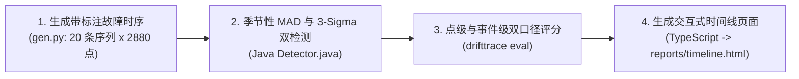

# drifttrace

[English](README.md) | [简体中文](README.zh-CN.md)

**针对真实故障事件告警，而不是机械对阈值越界告警。** `drifttrace` 使用“季节性基线 + 稳健 Z-Score（MAD）+ 短长方差比”检测时序指标异常，并在带标注的故障事件上对比朴素 3-Sigma 基线，报告精确率、召回率、事件检出率与误报数。

```console
$ python scripts/demo.py
rolling        P 0.934  R 0.579  F1 0.715   detected 100/108  false alarms 40
baseline       P 1.000  R 0.017  F1 0.033   detected 36/108  false alarms 0
```

## 操作工作流与流程图



## 检测原理

1. **季节性基线**：将每个采样点与前三天同一时刻的中位数对比（避免中心滚动中位数把阶跃变化拖宽半个窗口）。
2. **全局稳健尺度**：对整条残差序列计算单一 MAD，避免长阶跃污染局部方差尺度。
3. **双掩码与持续性规则**：Z-Score 掩码抓毛刺（spike）、跌落（dip）和水位阶跃（level shift）；平滑短长标准差比抓均值不变但噪声暴增的方差漂移（variance regime）。
4. **告警合并**：间距小于 5 个点的异常区间合并为同一条事件告警。

## 实测对比（20 条 10 天序列，108 个标注事件）

| 检测器 | Precision | Recall | F1 | 检出事件数 | 误报数 |
| --- | --- | --- | --- | --- | --- |
| 季节性基线 + MAD | 0.934 | 0.579 | 0.715 | 100/108 (92.6%) | 40 |
| 全局 3-Sigma | 1.000 | 0.017 | 0.033 | 36/108 (33.3%) | 0 |

单 JVM 线程处理 57,600 个采样点耗时仅 **0.62 秒**（约 9.3 万点/秒）。

## 快速开始与分步工作流

```bash
python scripts/demo.py
```

分步命令：

```bash
javac -d out java/src/drifttrace/Detector.java
java -cp out drifttrace.Detector --input data/series --out data/detections.json
java -cp out drifttrace.Detector --input data/series --out data/baseline.json --baseline --threshold 3
PYTHONPATH=python/src python -m drifttrace eval \
  --truth data/truth.json --detections data/detections.json \
  --baseline data/baseline.json --series data/series --out reports
```

## 已知限制与开发测试

- 默认假设日周期 `--period 288`（5 分钟采样），前三个周期为预热期不产生告警。
- 仅单序列独立检测，不包含跨序列关联。

```bash
PYTHONPATH=python/src python -m unittest discover -s python/tests -t python/tests -v
cd python && pip install -e ".[dev]" && ruff check . && mypy
```

MIT，详见 [LICENSE](LICENSE)。
